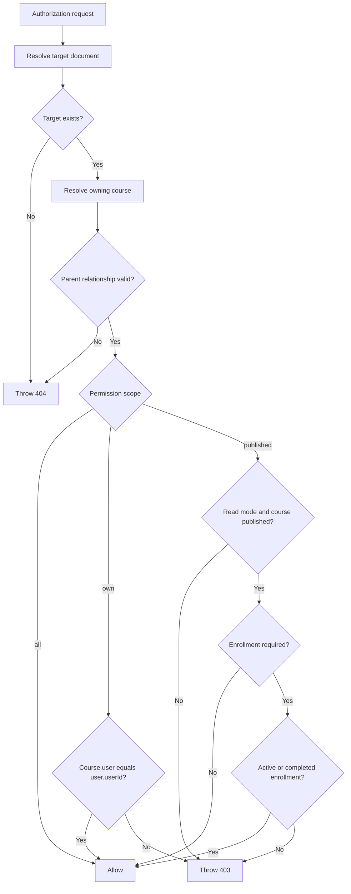

# `accessControl.js`

This module centralizes authorization for courses and course-owned content.

The file is located at [`src/utils/accessControl.js`](../src/utils/accessControl.js).

It supports these ownership relationships:

```text
Course   -> Course.user
Module   -> Module.course -> Course.user
Resource -> Resource.module -> Module.course -> Course.user
```

This allows services to authorize a course, module, or resource without duplicating relationship traversal logic.

## Permission scopes

The helper uses the permission scope attached to `user.permission.scope`.

| Scope | Meaning |
| --- | --- |
| `all` | Access any existing target document. |
| `own` | Access only when the resolved course belongs to `user.userId`. |
| `published` | Read published content. Protected content also requires an active or completed enrollment. Management is denied. |

Enrollment never grants management access.

## Enrollment statuses

```js
const activeEnrollmentStatuses = ["active", "completed"];
```

Only these enrollment statuses can grant published-content access:

- `active`
- `completed`

A `cancelled` enrollment does not grant access.

## Target resolver registry

```js
const targetResolvers = new Map([
    [Course.modelName, async (id) => Course.findById(id).select("user publicationStatus")],
    [Module.modelName, async (id) => Module.findById(id).select("course")],
    [Resource.modelName, async (id) => Resource.findById(id).select("module")],
]);
```

The registry defines how each supported model provides the information needed to reach its course.

Using a registry keeps model-specific relationship logic explicit. Adding another model requires adding a resolver and, when necessary, extending the relationship traversal in `resolveCourse`.

The queries use `.select()` to retrieve only authorization-related fields instead of loading complete documents.

## `authorizationError`

```js
function authorizationError(message = "Access prohibited !")
```

Creates a consistent authorization error:

- `name`: `AuthorizationError`
- `status`: `403`
- `message`: `Access prohibited !` by default

The Express error handler converts this into an HTTP `403` response.

## `notFoundError`

```js
function notFoundError(modelName)
```

Creates a consistent `404` error using the model name:

```text
Course not Found !
Module not Found !
Resource not Found !
```

Missing target documents and broken parent relationships are treated as not found.

## `isSameId`

```js
function isSameId(left, right)
```

Converts both values to strings before comparing them. This allows comparison between Mongoose `ObjectId` values and string IDs.

## `resolveCourse`

```js
async function resolveCourse(targetModel, targetId)
```

Resolves any supported target document to its owning course.

### Course target

For a `Course`, the target is already the owning course:

```text
Course -> Course
```

### Module target

For a `Module`, the helper reads `module.course`, then loads that course:

```text
Module -> Course
```

If the module has no course relationship, a course-not-found error is thrown.

### Resource target

For a `Resource`, the helper reads `resource.module`, loads the module, then reads `module.course`:

```text
Resource -> Module -> Course
```

Missing module or course relationships produce a `404` error instead of allowing authorization to continue with incomplete data.

### Return value

The function returns:

```js
{
    target,
    course
}
```

The target is the original document used for authorization. The course contains the owner and publication status.

Invalid MongoDB IDs that cause a Mongoose `CastError` are converted into a normal `404` error.

## `isActivelyEnrolled`

```js
async function isActivelyEnrolled(userId, courseId)
```

Checks whether the user has a matching enrollment:

```js
{
    learner: userId,
    course: courseId,
    status: { $in: ["active", "completed"] }
}
```

It uses `Enrollment.exists`, so it checks for existence without loading the full enrollment document.

## `authorizeTarget`

```js
async function authorizeTarget({
    Model,
    id,
    user,
    mode = "read",
    requireEnrollment = true,
})
```

This is the main helper for authorizing one target document.

### Input values

| Property | Description |
| --- | --- |
| `Model` | Supported Mongoose model, such as `Course`, `Module`, or `Resource`. |
| `id` | ID of the target document. |
| `user` | Authenticated user containing `userId` and `permission.scope`. |
| `mode` | Either `read` or `manage`. |
| `requireEnrollment` | Whether published read access requires enrollment. |

### Authorization flow

1. Resolve the target and its owning course with `resolveCourse`.
2. Read the user's permission scope.
3. Apply the scope-specific policy.
4. Return `{ target, course }` when access is allowed.
5. Throw a `403` error when access is denied.

### `all` scope

```js
if (scope === "all") {
    return { target, course };
}
```

The user can access any existing supported target. The target and its parent relationships must still exist, so missing documents produce `404` errors.

### `own` scope

```js
course.user === user.userId
```

Ownership is always checked against the resolved course, not against a child module or resource.

For example, a trainer can manage a module only when the trainer owns the course containing that module.

### `published` scope

Published scope is read-only:

```js
mode === "read"
```

The owning course must have:

```js
publicationStatus === "published"
```

When `requireEnrollment` is true, the user must also have an active or completed enrollment in that course.

A published-scope user is denied when:

- The operation is `manage`.
- The course is not published.
- Enrollment is required but the user is not actively enrolled.

### Example: module read

```js
await authorizeTarget({
    Model: Module,
    id: moduleId,
    user,
    mode: "read",
});
```

The helper resolves:

```text
Module -> Course
```

Then it checks the user's scope against the course owner, publication status, and enrollment status.

### Example: resource management

```js
await authorizeTarget({
    Model: Resource,
    id: resourceId,
    user,
    mode: "manage",
});
```

The helper resolves:

```text
Resource -> Module -> Course
```

A learner's enrollment cannot authorize this operation because `published` scope is read-only.

## `getAccessibleCourseFilter`

```js
async function getAccessibleCourseFilter(
    user,
    { requireEnrollment = false } = {},
)
```

Builds a MongoDB filter for querying courses in bulk.

### Returned filters

| Scope | Returned filter |
| --- | --- |
| `all` | `{}` |
| `own` | `{ user: user.userId }` |
| `published` | `{ publicationStatus: "published" }` |

When `requireEnrollment` is true for `published` scope, the helper first finds the user's active or completed enrollment course IDs and adds:

```js
{
    _id: { $in: enrolledCourseIds }
}
```

This function is useful for course lists because it produces a MongoDB filter without authorizing each result individually.

## `getAccessibleFilter`

```js
async function getAccessibleFilter(Model, user, options = {})
```

Builds a MongoDB filter for supported models, using the accessible courses as the source of truth.

### Course filter

For `Course`, it returns the filter from `getAccessibleCourseFilter` directly.

### Module filter

It first finds accessible course IDs, then returns:

```js
{
    course: { $in: courseIds }
}
```

### Resource filter

It finds modules belonging to accessible courses, then returns:

```js
{
    module: { $in: moduleIds }
}
```

This preserves the relationship chain:

```text
Resource -> Module -> Course
```

The resulting filter can be passed directly to `Model.find` and `Model.countDocuments` so pagination totals use the same access boundary as the returned documents.

## Single target versus list authorization

Use `authorizeTarget` when working with one document:

```js
await authorizeTarget({ Model, id, user, mode: "read" });
```

Use `getAccessibleFilter` when listing many documents:

```js
const filter = await getAccessibleFilter(Module, user, {
    requireEnrollment: true,
});

const modules = await Module.find(filter);
```

The single-target helper throws immediately on denial. The list helper returns a MongoDB filter so unauthorized documents are excluded from the query.

## Decision flow



## Adding a new model

To add authorization for another course-owned model:

1. Import the model into `accessControl.js`.
2. Add a resolver to `targetResolvers` that selects the relationship needed to reach the course.
3. Extend `resolveCourse` if the relationship path differs from the existing course, module, or resource paths.
4. Add the model's bulk filter behavior to `getAccessibleFilter`.
5. Use `authorizeTarget` in the service for single-document reads and mutations.
6. Use `getAccessibleFilter` for list and count queries.

The service should not duplicate course ownership traversal or enrollment checks.
