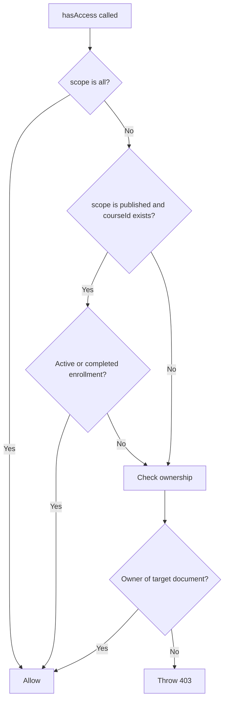

# `checkOwnership.js`

This file contains two authorization helpers:

- `isHeEnrolletOn`: checks whether a learner has an active enrollment in a course.
- `hasAccess`: decides whether a user can access a resource based on a permission scope, enrollment, or ownership.

The file is located at [`src/utils/checkOwnership.js`](../src/utils/checkOwnership.js).

## `isHeEnrolletOn`

```js
async function isHeEnrolletOn(userId, courseId)
```

The function searches the `Enrollment` collection using three conditions:

```js
{
    learner: userId,
    course: courseId,
    status: { $in: ["active", "completed"] }
}
```

It returns:

- `true` when the user has an `active` or `completed` enrollment.
- `false` when no matching enrollment exists.

A `cancelled` enrollment does not grant access.

## `hasAccess`

```js
async function hasAccess(ownership, scope, courseId = false)
```

This function does not return a boolean. It resolves successfully when access is allowed and throws an error when access is denied.

### Parameters

| Parameter | Description |
| --- | --- |
| `ownership` | Object describing the user and the document to check. |
| `scope` | Permission scope: `all`, `own`, or `published`. |
| `courseId` | Optional course ID used for enrollment checks. |

The `ownership` object must contain the values required by `isHeOwningThat`:

```js
{
    userId: user.userId,
    thingId: courseId,
    Model: Course,
    field: "user"
}
```

Meaning:

- `userId`: the authenticated user's ID.
- `thingId`: the document ID to load.
- `Model`: the Mongoose model containing the document.
- `field`: the field containing the owner's user ID.

## Access flow

### 1. `all` scope

```js
await hasAccess(ownership, "all")
```

The function immediately considers access allowed. It does not perform an ownership or enrollment check.

The target document may still be queried by the calling service separately.

### 2. `published` scope with a course ID

```js
await hasAccess(ownership, "published", courseId)
```

The function checks whether the authenticated user has an `active` or `completed` enrollment in `courseId`.

If the user is enrolled, access is granted.

### 3. Ownership fallback

If access has not already been granted, the function calls [`isHeOwningThat`](../src/utils/isHeOwningThat.js).

That helper:

1. Loads the target document with `Model.findById(thingId)`.
2. Returns a `404` result when the document does not exist.
3. Compares `thing[field]` with `userId`.
4. Returns a successful result when the IDs match.
5. Returns a `403` result when the IDs do not match.

This means an owner can pass the ownership check even when the scope is `published`.

### 4. Denial

If neither enrollment nor ownership grants access, `hasAccess` throws:

```js
const error = new Error("you dont have access to this Course!")
error.status = 403
throw error
```

The Express error handler converts this into an HTTP `403` response.

## Decision flow



## Important behavior

This helper checks enrollment and ownership, but it does **not** check the course's `publicationStatus` field. A caller that needs to enforce publication must check that separately or use the centralized authorization helper in [`src/utils/accessControl.js`](../src/utils/accessControl.js).

Also, `hasAccess` checks ownership using the exact `Model` and `field` supplied by the caller. For child documents such as modules or resources, the caller must pass the owning course as the target or use the centralized relationship-aware helper.

## Example

```js
const ownership = {
    userId: user.userId,
    thingId: courseId,
    Model: Course,
    field: "user",
};

await hasAccess(
    ownership,
    user.permission.scope,
    user.permission.scope === "published" ? courseId : false,
);
```

Possible results:

- The promise resolves when the scope is `all`.
- The promise resolves when the user owns the course.
- The promise resolves when a `published`-scope user has an active or completed enrollment.
- The promise rejects with status `403` otherwise.
- A missing target document is normally converted into a `403` by `hasAccess`, because `isHeOwningThat` returns the `404` as a result object and `hasAccess` only checks `result.success`.
